<!-- Troque SEU_USUARIO pelo seu @ do GitHub (aparece em 3 lugares: stats, top-langs e streak) -->
<!-- Suba também o arquivo matrix-banner.svg na raiz do repositório, junto com este README -->

<div align="center">




</div>

---

```bash
$ whoami
brenno_muller

$ cat role.txt
Analista de Dados | Power BI | Python | SQL | ETL | ML

$ status
> online @ Sicredi  [ONLINE]
```

## `> sobre_mim.exe`

Sou **Analista de Dados** com experiência em **análise de dados, modelagem, Business Intelligence e Machine Learning**, com passagem por uma **multinacional do segmento químico** e por **instituições de pesquisa, desenvolvimento e inovação**.

Trabalho com coleta, limpeza e tratamento de dados, **pipelines ETL**, análise estatística, **modelos preditivos**, integração de APIs e automação de processos, sempre com foco em gerar **insights que apoiem a tomada de decisão**.

- 💼 Atualmente **Analista de Dados Júnior no Sicredi**
- 🌾 Atuei com dados agrícolas na **BASF** (via Zeentech)
- 🔬 Fui **pesquisador de Iniciação Científica** no **IF Goiano** e no **Polo de Inovação IF Goiano – Embrapii**
- 🐟 Tenho **publicação** e **patente** em Machine Learning/visão computacional aplicada à aquicultura
- 🎓 Formação em **Ciência da Computação** (IF Goiano)
- 🌐 Inglês: **Professional Working**
- 💬 Pergunte-me sobre: **Power BI, Python, SQL, ETL e Machine Learning**

---

## `> contato.sh`

<div align="center">

<a href="https://www.linkedin.com/in/brenno-muller-vitorino/"></a>
<a href="mailto:brennomillervitorino2016@gmail.com"></a>

</div>

---

## `> ferramentas --list`

<div align="center">


</div>

---

## `> tech_stack.json`

<div align="center">


</div>

---

## `> experiencia.log`

| Período | Cargo | Empresa |
|---|---|---|
| Jul/2026 – atual | **Analista de Dados Júnior** | Sicredi |
| Out/2024 – Jun/2026 | **Assistente de Processamento de Dados Agrícolas** | BASF (via Zeentech) |
| Mai/2024 – Mai/2025 | **Pesquisador de Iniciação Científica** | Polo de Inovação IF Goiano – Embrapii |
| Jan/2023 – Dez/2023 | **Pesquisador de Iniciação Científica** | IF Goiano |
| Jan/2022 – Jan/2023 | **Estagiário** | OnPeixes |

---

## `> destaque_ml.py`

Na **OnPeixes**, desenvolvi um projeto de **processamento de imagens e análise de dados para estimar o peso de peixes** a partir de imagens:

- Treinamento de modelos de **Deep Learning** para segmentação dos alevinos
- Extração de características morfológicas e espaciais como variáveis
- Modelos de **Machine Learning** para predição automatizada do peso

📄 **Publicação:** *Machine learning in estimating the weight of Tilapia Oreochromis niloticus juveniles*
🏅 **Patente:** *Sistema de contagem de alevinos de tilápia*

---

## `> github_stats --live`

<div align="center">


</div>

---

<div align="center">


`There is no spoon.`

</div>
